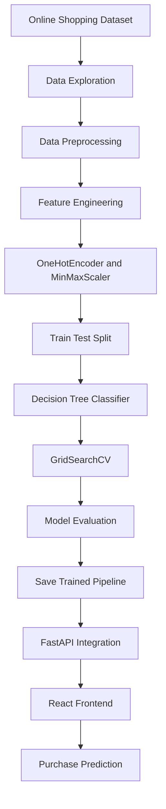
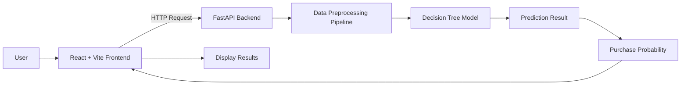

# ShopSense – AI-Powered Purchase Prediction System

<p align="center">
  
</p>

<p align="center">
  <strong>An intelligent machine learning application that predicts customer purchase behaviour using online shopping session data.</strong>
</p>

<p align="center">
  <a href="https://shop-sense-mu.vercel.app/">
    
  </a>
  <a href="https://shopsense-api-m8sx.onrender.com/docs">
    
  </a>
</p>

---

## Overview

ShopSense is an AI-powered web application designed to predict whether a customer is likely to make a purchase based on their online shopping session behaviour.

The application uses a trained Decision Tree classification model integrated with a FastAPI backend and React frontend to deliver real-time predictions and purchase probability.

The primary goal is to demonstrate how machine learning can be integrated into a modern web application to analyze customer behaviour and support data-driven e-commerce decisions.

## Live Application

| Component | URL |
|---|---|
| Frontend Application | https://shop-sense-mu.vercel.app/ |
| Backend API | https://shopsense-api-m8sx.onrender.com |
| Swagger API Documentation | https://shopsense-api-m8sx.onrender.com/docs |

## Key Features

- Customer purchase behaviour prediction.
- Machine learning-based classification.
- Real-time purchase probability estimation.
- Interactive React user interface.
- FastAPI REST API integration.
- Automated data preprocessing pipeline.
- Decision Tree model optimization using GridSearchCV.
- Prediction results with class probabilities.
- Cloud deployment using Vercel and Render.

## Technology Stack

<p align="center">
  
</p>

| Category | Technologies |
|---|---|
| Frontend | React.js, Vite |
| Backend | Python, FastAPI |
| Machine Learning | Scikit-learn |
| Data Processing | Pandas, NumPy |
| Data Preprocessing | MinMaxScaler, OneHotEncoder |
| Algorithm | Decision Tree Classifier |
| Hyperparameter Tuning | GridSearchCV |
| Model Serialization | Pickle |
| API Testing | Swagger UI |
| Deployment | Vercel, Render |
| Version Control | Git, GitHub |

## Machine Learning Workflow

The project follows a structured machine learning workflow, starting from dataset exploration to model deployment.



## Dataset Information

The project uses an online shopping customer behaviour dataset containing session-level information.

| Description | Value |
|---|---:|
| Total Records | 12,330 |
| Total Features | 18 |
| Training Records | 9,864 |
| Testing Records | 2,466 |

### Data Preprocessing

The following preprocessing techniques are used:

- Data cleaning and exploration.
- Handling categorical features using OneHotEncoder.
- Scaling numerical features using MinMaxScaler.
- Feature transformation using Scikit-learn pipelines.
- Splitting data into training and testing datasets.

## Model Development

ShopSense uses a Decision Tree Classifier to predict customer purchase behaviour.

### Hyperparameter Optimization

GridSearchCV is used to identify suitable hyperparameters and improve model performance.

Best model configuration:

```python
DecisionTreeClassifier(
    max_depth=4,
    min_samples_leaf=5,
    min_samples_split=2,
    class_weight=None
)
```

### Model Performance

The tuned Decision Tree model achieved the following results on the test dataset.

| Evaluation Metric | Score |
|---|---:|
| Accuracy | 89.62% |
| Precision | 77.39% |
| Recall | 46.60% |
| F1-Score | 58.17% |

*These metrics represent the tuned model's reported test-set performance.*

## System Architecture

ShopSense follows a frontend-backend architecture in which the React application communicates with the FastAPI backend through REST API requests.



### Prediction Process

1. The user enters customer shopping-session information.
2. The React frontend sends the input to the FastAPI backend.
3. FastAPI validates the input using Pydantic.
4. The preprocessing pipeline transforms the input features.
5. The trained Decision Tree model generates a prediction.
6. The backend calculates purchase probability and class probabilities.
7. The frontend displays the prediction results.

## API Documentation

ShopSense exposes its machine learning model through REST API endpoints using FastAPI.

### Available Endpoints

| Method | Endpoint | Description |
|---|---|---|
| GET | `/` | API welcome endpoint |
| GET | `/health` | Backend health check |
| POST | `/predict` | Customer purchase prediction |

### Prediction Endpoint

**Endpoint:**

```http
POST /predict
```

The endpoint accepts customer shopping-session features and returns a purchase prediction with probability information.

### Sample API Response

```json
{
  "prediction": 1,
  "result": "Purchase",
  "purchase_probability": 0.85,
  "purchase_probability_percent": 85,
  "class_probabilities": {
    "0": 0.15,
    "1": 0.85
  }
}
```

*Illustrative response. Actual predictions depend on customer input.*

### Swagger Documentation

Test and explore the API endpoints using FastAPI Swagger UI:

https://shopsense-api-m8sx.onrender.com/docs

## Project Structure

```text
ShopSense/
│
├── ml_model/
│   ├── app.py
│   ├── requirements.txt
│   │
│   └── models/
│       └── decision_tree_pipeline.pkl
│
├── frontend/
│   ├── public/
│   ├── src/
│   │   ├── components/
│   │   ├── App.jsx
│   │   ├── main.jsx
│   │   └── ...
│   │
│   ├── package.json
│   ├── vite.config.js
│   └── index.html
│
└── README.md
```

## Installation and Setup

Follow these steps to run ShopSense locally.

### 1. Clone the Repository

```bash
git clone YOUR_GITHUB_REPOSITORY_URL
cd ShopSense
```

### 2. Backend Setup

Navigate to the backend directory:

```bash
cd ml_model
```

Create a Python virtual environment:

```bash
python -m venv venv
```

Activate the virtual environment.

**Windows:**

```bash
venv\Scripts\activate
```

**Linux / macOS:**

```bash
source venv/bin/activate
```

Install the required dependencies:

```bash
pip install -r requirements.txt
```

Start the FastAPI application:

```bash
uvicorn app:app --reload
```

Backend runs at:

```text
http://127.0.0.1:8000
```

### 3. Frontend Setup

Open another terminal and navigate to the frontend directory:

```bash
cd frontend
```

Install the dependencies:

```bash
npm install
```

Create a `.env` file inside the frontend directory:

```env
VITE_API_URL=http://127.0.0.1:8000
```

Start the React development server:

```bash
npm run dev
```

Frontend runs at:

```text
http://localhost:5173
```

## Deployment

ShopSense uses separate cloud platforms for frontend and backend deployment.

### Frontend Deployment – Vercel

The React + Vite frontend is deployed using Vercel.

Production environment variable:

```env
VITE_API_URL=https://shopsense-api-m8sx.onrender.com
```

Live application:

https://shop-sense-mu.vercel.app/

### Backend Deployment – Render

The FastAPI backend is deployed using Render.

Start command:

```bash
uvicorn app:app --host 0.0.0.0 --port $PORT
```

Ensure that the backend CORS configuration allows requests from the deployed frontend domain.

Backend URL:

https://shopsense-api-m8sx.onrender.com

## Security Considerations

- Sensitive environment variables should never be committed to GitHub.
- API credentials and database connection strings should be stored as environment variables.
- Frontend environment variables prefixed with `VITE_` are publicly accessible.
- CORS should be configured to allow only trusted frontend origins.
- Avoid uploading private datasets or confidential customer information.

## Future Enhancements

- Compare multiple machine learning algorithms.
- Improve recall using class imbalance handling techniques.
- Integrate Explainable AI using SHAP.
- Introduce customer segmentation.
- Build interactive customer behaviour analytics.
- Integrate additional shopping behaviour datasets.
- Explore advanced ensemble learning techniques.

## Author

**Dinesh Bala KS**

B.Tech – Artificial Intelligence and Data Science

Email: dineshbalaks@gmail.com

<p align="center">
  <a href="https://shop-sense-mu.vercel.app/">
    Visit ShopSense
  </a>
</p>

---

<p align="center">
  
</p>

<p align="center">
  If you find this project useful, consider starring the repository.
</p>
