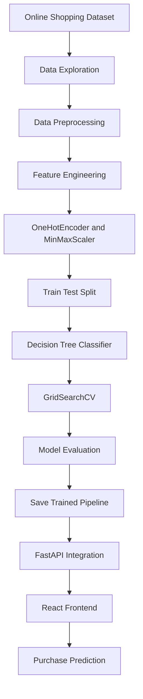
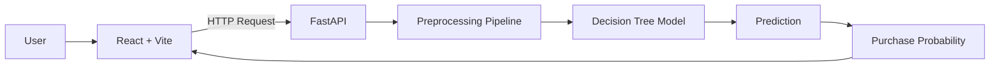

# ShopSense – AI-Powered Purchase Prediction System

<p align="center">
  
</p>

<p align="center">
  <strong>An intelligent machine learning application that predicts customer purchase behaviour using online shopping session data.</strong>
</p>

<p align="center">
  <a href="https://shop-sense-mu.vercel.app/">
    
  </a>
  <a href="https://shopsense-api-m8sx.onrender.com/docs">
    
  </a>
</p>

---

## Overview

ShopSense is an AI-powered web application designed to predict whether a customer is likely to make a purchase based on their online shopping session behaviour.

The system uses a trained Decision Tree classification model and integrates it with a FastAPI backend and React frontend to deliver real-time predictions and purchase probability.

## Live Application

| Component | URL |
|---|---|
| Frontend | https://shop-sense-mu.vercel.app/ |
| Backend API | https://shopsense-api-m8sx.onrender.com |
| Swagger Documentation | https://shopsense-api-m8sx.onrender.com/docs |

## Key Features

- Customer purchase behaviour prediction.
- Machine learning-based classification.
- Real-time purchase probability estimation.
- Interactive React user interface.
- FastAPI REST API integration.
- Automated data preprocessing pipeline.
- Optimized Decision Tree model using GridSearchCV.
- Cloud deployment with Vercel and Render.

## Technology Stack

<p align="center">
  
</p>

| Category | Technologies |
|---|---|
| Frontend | React.js, Vite |
| Backend | Python, FastAPI |
| Machine Learning | Scikit-learn |
| Data Processing | Pandas, NumPy |
| Preprocessing | MinMaxScaler, OneHotEncoder |
| Algorithm | Decision Tree Classifier |
| Hyperparameter Tuning | GridSearchCV |
| Model Storage | Pickle |
| Deployment | Vercel, Render |

## Machine Learning Workflow



## Dataset Information

The project uses an online shopping customer behaviour dataset.

| Description | Value |
|---|---:|
| Total Records | 12,330 |
| Total Features | 18 |
| Training Records | 9,864 |
| Testing Records | 2,466 |

## Model Performance

The tuned Decision Tree model achieved the following results on the test dataset:

| Evaluation Metric | Score |
|---|---:|
| Accuracy | 89.62% |
| Precision | 77.39% |
| Recall | 46.60% |
| F1-Score | 58.17% |

### Model Configuration

```python
DecisionTreeClassifier(
    max_depth=4,
    min_samples_leaf=5,
    min_samples_split=2,
    class_weight=None
)
```

## System Architecture



## API Endpoints

| Method | Endpoint | Description |
|---|---|---|
| GET | `/` | API welcome endpoint |
| GET | `/health` | Backend health check |
| POST | `/predict` | Customer purchase prediction |

### Sample Prediction Response

```json
{
  "prediction": 1,
  "result": "Purchase",
  "purchase_probability": 0.85,
  "purchase_probability_percent": 85,
  "class_probabilities": {
    "0": 0.15,
    "1": 0.85
  }
}
```

*Illustrative response. Actual predictions depend on customer input.*

## Project Structure

```text
ShopSense/
│
├── ml_model/
│   ├── app.py
│   ├── requirements.txt
│   └── models/
│       └── decision_tree_pipeline.pkl
│
├── frontend/
│   ├── public/
│   ├── src/
│   │   ├── components/
│   │   ├── App.jsx
│   │   └── main.jsx
│   ├── package.json
│   └── vite.config.js
│
└── README.md
```

## Installation and Setup

### 1. Clone Repository

```bash
git clone YOUR_GITHUB_REPOSITORY_URL
cd ShopSense
```

### 2. Backend Setup

```bash
cd ml_model

python -m venv venv

# Windows
venv\Scripts\activate

# Install dependencies
pip install -r requirements.txt

# Run FastAPI
uvicorn app:app --reload
```

Backend URL:

`http://127.0.0.1:8000`

### 3. Frontend Setup

```bash
cd frontend

npm install
```

Create a `.env` file:

```env
VITE_API_URL=http://127.0.0.1:8000
```

Start the frontend:

```bash
npm run dev
```

Frontend URL:

`http://localhost:5173`

## Deployment

| Service | Platform |
|---|---|
| Frontend | Vercel |
| Backend | Render |

### Frontend Environment Variable

```env
VITE_API_URL=https://shopsense-api-m8sx.onrender.com
```

### Backend Start Command

```bash
uvicorn app:app --host 0.0.0.0 --port $PORT
```

Configure CORS to allow your deployed frontend domain.

## Future Enhancements

- Compare multiple machine learning algorithms.
- Improve recall through class imbalance handling.
- Add explainable AI using SHAP.
- Introduce customer segmentation.
- Build interactive purchase behaviour analytics.
- Integrate additional customer behaviour datasets.

## Author

**Dinesh Bala KS**

B.Tech – Artificial Intelligence and Data Science

---

<p align="center">
  
</p>

<p align="center">
  If you find this project useful, consider starring the repository.
</p>
